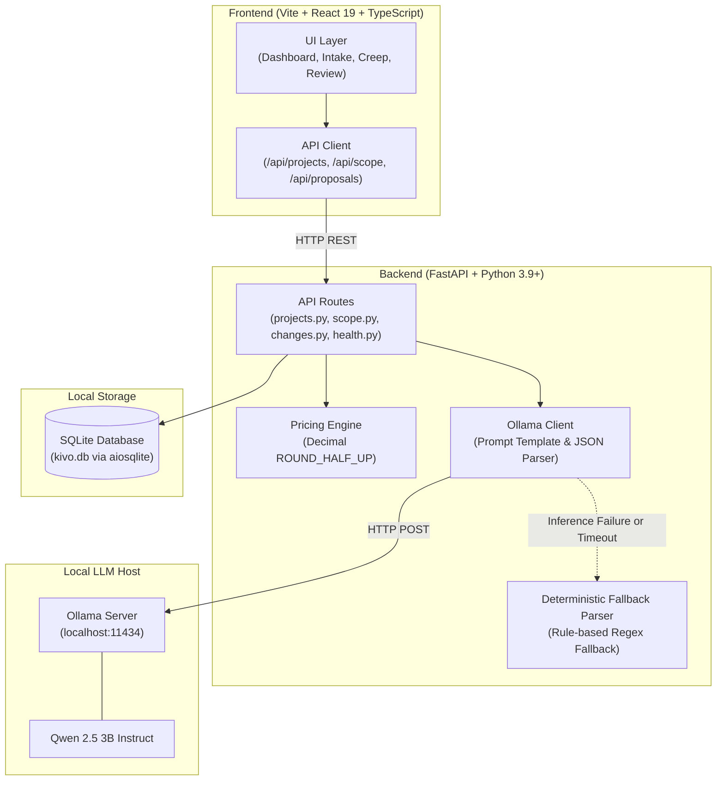

# Kivo

> **Stop guessing. Start scoping.**

[](https://react.dev/)
[](https://www.typescriptlang.org/)
[](https://fastapi.tiangolo.com/)
[](https://www.python.org/)
[](https://sqlite.org/)
[](https://ollama.ai/)

Kivo is a local-first, privacy-focused scope management application for freelancers and independent software developers. It transforms ambiguous client briefs into defensible, locked scope baselines, detects out-of-scope additions in client messages, and generates transparent, itemized change orders with deterministic pricing — powered by a local language model running entirely on your machine.

---

## Screenshots

> *Screenshots can be placed in `docs/screenshots/` and linked below once captured.*

### 1. Dashboard & Project Ledger
*Overview of active client engagements, locked baseline contracts, approved change orders, and the reconciled financial ledger.*

```
[ Screenshot Placeholder: docs/screenshots/dashboard.png ]
```

### 2. Scope Intake & AI Boundary Extraction
*Transforming free-text RFP briefs into structured requirements, assumptions, out-of-scope exclusions, and clarification questions.*

```
[ Screenshot Placeholder: docs/screenshots/scope-intake.png ]
```

### 3. Scope Creep Detector & Change Order Generator
*Analyzing incoming client requests against the locked baseline, identifying scope deltas, and previewing billable additions.*

```
[ Screenshot Placeholder: docs/screenshots/scope-creep.png ]
```

### 4. Client Review & Approval Portal
*Standalone client-facing addendum page showing baseline contracts, itemized change requests, and approval actions.*

```
[ Screenshot Placeholder: docs/screenshots/client-review.png ]
```

---

## The Problem and Solution

### The Problem: Unbilled Scope Creep
For freelancers, scope creep rarely starts with major pushback; it arrives in casual messages: *"Could you also quickly add a PDF export button, multi-currency conversion, and a sharing popup before launch?"* 

Without a locked baseline and formal change-management process, freelancers face an uncomfortable dilemma: absorb hours of unbilled work or engage in awkward, unstructured renegotiations.

### The Solution: Defensible, Local-First Scope Control
Kivo provides a deterministic, transparent workflow to protect freelance engagements:

1. **Establish an Immutable Baseline**: Parses raw client briefs into discrete deliverables, explicit exclusions, and assumptions before development begins.
2. **Detect Scope Deltas**: Evaluates new client requests directly against the agreed baseline to isolate out-of-scope additions.
3. **Deterministic Pricing**: Calculates billable deltas using exact decimal arithmetic (`Decimal` with `ROUND_HALF_UP`) based on agreed hourly rates.
4. **Client-Facing Signoff**: Provides a shareable portal where clients can review line items, inspect baseline contracts, and record formal approval or rejection.

---

## Key Features

- **Structured Scope Extraction**: Converts raw brief text into categorised deliverables, assumptions, exclusions, and clarification questions.
- **Provenance Tracking**: Clearly distinguishes client-stated deliverables (`explicit`) from AI-suggested implementation details (`suggested`).
- **Editable Deliverables & Boundaries**: Adjust hour estimates, task titles, and complexity ratings before finalizing.
- **Baseline Scope Locking**: Locks agreed deliverables and pricing into an immutable SQLite record prior to project kickoff.
- **Scope-Delta Identification**: Detects whether client messages introduce new features, scope expansions, or clarifications.
- **Itemized Change Orders**: Automatically generates clear addenda breaking down additional hours and costs.
- **Client Approval & Rejection Flow**: Shareable tokenized page allowing clients to approve additions, decline requests, or submit feedback.
- **Project Ledger Reconciliation**: Real-time formula ensures totals reconcile without discrepancies:
  $$\text{Baseline Contract} + \text{Approved Changes} = \text{Total Project Ledger}$$
- **Duplicate Request Protection**:
  - Reuses pending proposal tokens for equivalent client messages, preventing duplicate entries.
  - Blocks duplicate generation for already-approved change orders with HTTP 409 Conflict.
- **Local-First AI with Offline Fallback**: All inference runs locally via Ollama with zero external API dependencies. A deterministic fallback parser ensures uninterrupted operation if the local model is offline.

---

## Demo Walkthrough

Follow this reproducible workflow to test Kivo locally:

1. **Explore the Dashboard**: Open `http://localhost:5173`. Review existing engagements (e.g., *Acme SaaS Portal* or *Fintech Mobile App MVP*), inspect the agreed baseline effort, and view approved change orders.
2. **Draft a Scope Baseline**: Navigate to **Scope Intake**. Paste an RFP brief or click one of the pre-loaded sample briefs. Click **Extract Defensible Scope**. Review the extracted requirements and provenance tags (`Client Explicit` vs `AI Suggested`).
3. **Lock the Baseline**: Adjust effort hours or add clarifications as needed, then click **Save & Lock Scope Baseline**. The scope is now frozen in SQLite.
4. **Detect Scope Creep**: Navigate to **Scope Creep**. Select your project and paste a client request (e.g., *"Can we add an automated statement export to PDF?"*). Click **Analyze Scope Creep**. Review the flagged scope additions.
5. **Generate a Change Order**: Enter a title and click **Generate Change Proposal**. Kivo generates a secure token link (e.g., `/proposals/<token>`).
6. **Client Signoff & Reconciliation**: Open the proposal link in the **Customer Review Portal**. Review the immutable baseline contract alongside the new change items. Enter client notes and click **Approve Scope Addition**. Return to the **Dashboard** to confirm that the project ledger reconciles immediately.

---

## Architecture



### Data Model (SQLite)

| Table | Purpose | Key Attributes |
|---|---|---|
| `projects` | Engagement metadata | `id`, `name`, `client_name`, `hourly_rate`, `currency`, `status` |
| `scope_baselines` | Immutable baseline contract | `id`, `project_id`, `total_estimated_hours`, `total_baseline_price` |
| `scope_items` | Discrete deliverables & boundaries | `scope_baseline_id`, `category`, `title`, `suggested_hours`, `provenance` |
| `change_requests` | Change order proposals | `id`, `project_id`, `status` (*sent/approved/rejected/superseded*), `share_token` |
| `change_items` | Individual change deliverables | `change_request_id`, `title`, `impact_type`, `estimated_hours` |

---

## Tech Stack and Local Setup

### Technology Stack
- **Frontend**: React 19, TypeScript, Vite, Tailwind CSS, Lucide React
- **Backend**: FastAPI, Python 3.9+, Pydantic v2, aiosqlite, HTTPX, Uvicorn
- **Database**: SQLite 3 (managed asynchronously via `aiosqlite`)
- **Local AI**: Ollama with `qwen2.5:3b`

### Prerequisites
- **Python**: Version 3.9 or higher
- **Node.js**: Version 18 or higher (with `npm`)
- **Ollama**: Installed from [ollama.ai](https://ollama.ai/)

---

### Step-by-Step Installation

#### 1. Download Local AI Model
In your terminal, pull the recommended 3-billion parameter model:

```bash
ollama pull qwen2.5:3b
```

Ensure Ollama is running in the background (`http://localhost:11434`).

#### 2. Backend Setup
From the repository root:

```bash
cd backend
python3 -m venv venv
source venv/bin/activate       # On Windows: venv\Scripts\activate
pip install -r requirements.txt
```

#### 3. Frontend Setup
From the repository root:

```bash
cd frontend
npm install
```

---

### Running the Application

Open two separate terminal windows:

**Terminal 1 — Backend:**
```bash
cd backend
PYTHONPATH=. venv/bin/uvicorn app.main:app --reload --port 8000
```

**Terminal 2 — Frontend:**
```bash
cd frontend
npm run dev
```

Open your browser to **http://localhost:5173**.

To verify backend connectivity and Ollama model status, inspect the health endpoint at **http://localhost:8000/api/health**.

---

## Tests and Verification

### Backend Pytest Suite
The backend includes a comprehensive automated test suite covering unit pricing logic, API routes, regression safeguards, and workflow validation.

Run the test suite from the `backend/` directory:

```bash
PYTHONPATH=. pytest tests/ -v
```

**Test Coverage (23 tests across 4 test modules):**

| Test Module | Scope of Coverage |
|---|---|
| `tests/test_api.py` | Health checks, input validation, and project CRUD operations |
| `tests/test_pricing_engine.py` | Hourly rate multiplication, fractional hours (0.25h increments), negative-value guards, and Decimal rounding |
| `tests/test_quality_regression.py` | Provenance classification, approval persistence across refresh, ledger reconciliation, proposal deduplication, pending reuse, HTTP 409 conflict detection, superseded order exclusion, and offline fallback |
| `tests/test_workflow.py` | End-to-end scope intake lifecycle and error-handling boundary states |

*Status: All 23 tests passing.*

### Frontend Production Build
Validate TypeScript types and compile the optimized production bundle:

```bash
cd frontend
npm run build
```

*Status: Production build compiles cleanly with zero TypeScript errors.*

---

## Security, Privacy, Limitations, and Roadmap

### Privacy & Security Highlights
- **100% Local Inference**: Client briefs and sensitive project communications never leave your local environment.
- **Zero Third-Party API Keys**: Operates without external cloud LLM dependencies, API keys, or billing accounts.
- **SQL Injection Defenses**: All database interactions use parameterized SQL statements through `aiosqlite`.
- **Idempotency & Double-Billing Defenses**: Change request generation utilizes text normalization, per-project locks, and conflict verification to prevent ledger corruption.

### Current Limitations
- **Single-User Workspace**: Designed for independent freelancers working on a single machine; multi-user permissions and role-based access control (RBAC) are not implemented.
- **Non-Binding Cost Estimates**: Calculations are structured estimates to assist billing discussions; they do not constitute formal legal counsel or legally binding contracts.
- **Local Storage**: Data is stored in a local SQLite file (`kivo.db`). Multi-device cloud synchronization is not currently supported.
- **Manual Link Distribution**: Change order review links must be copied and shared with clients manually (email/SMS delivery is not integrated).

### Planned Improvements
- [ ] Exportable PDF change order addenda with cryptographic timestamping.
- [ ] Custom hourly rate profiles per deliverable category (e.g., architecture vs design).
- [ ] Webhook integration for real-time notifications (Slack, Discord) on client decision.
- [ ] CSV / JSON ledger export for import into accounting platforms.

---

## Contributing and License

### Contributing
Contributions, issue reports, and feedback are welcome. If you are submitting code changes:
1. Fork the repository and create your feature branch.
2. Ensure backend tests pass (`PYTHONPATH=. pytest tests/ -v`).
3. Ensure frontend builds cleanly (`npm run build`).
4. Submit a clear, descriptive pull request.

### License
No formal open-source license has been applied to this repository yet. All rights are currently reserved by the author.
